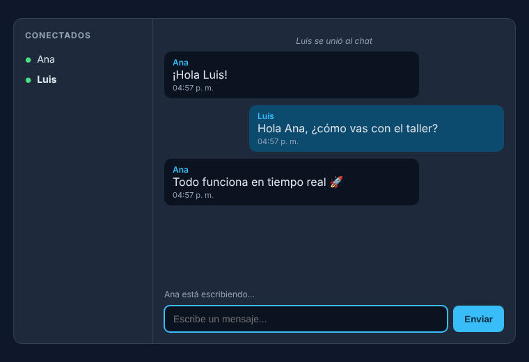

<!--
  ╔════════════════════════════════════════════════════════════════╗
  ║  PLANTILLA DE ENTREGA — Taller de chat con Socket.IO           ║
  ╠════════════════════════════════════════════════════════════════╣
  ║  1. Renombra este archivo a README.md (reemplaza el que viene  ║
  ║     con el taller: ese es el enunciado, no tu entrega).        ║
  ║  2. Llena TODO lo que diga [...] y borra los comentarios como  ║
  ║     este, que van entre <!-- y -->                             ║
  ║  3. Marca con [x] lo que hiciste. No marques lo que no sirve:  ║
  ║     se revisa corriendo el código.                             ║
  ╚════════════════════════════════════════════════════════════════╝
-->

# Chat en tiempo real con Socket.IO

**Estudiante:** Juan Esteban Sosa
**Código:** 2220242042
**Materia / grupo:** [...]
**Fecha de entrega:** 29/10/2026
**Repositorio:** [(https://github.com/JuanesSosa/TallerChat)]


---

## 1. Cómo correr el proyecto

```bash
git clone [https://github.com/JuanesSosa/TallerChat]
cd [TallerChat]
npm install
npm start
```

Luego abre `http://localhost:3000` en **dos ventanas** del navegador
(una en modo incógnito) para chatear contigo mismo.

**Versión de Node usada:** v22.23.4

---

## 2. Eventos de Socket.IO que implementé

| Evento | Lo emite | Lo escucha | Qué datos lleva | Quién lo recibe |
|---|---|---|---|---|
| `entrar` | Cliente | Servidor | `nombre` (string) | Solo el servidor |
| `sistema` | Servidor | Cliente | `texto` (string): "X se unió al chat" / "X salió del chat" | Todos (`io.emit`) |
| `mensaje` (cliente → servidor) | Cliente | Servidor | `texto` (string); el autor NO viaja | Solo el servidor |
| `mensaje` (servidor → clientes) | Servidor | Cliente | `{ autor, texto, hora }`; el autor sale de `usuarios.get(socket.id)` | Todos (`io.emit`), incluido quien lo escribió |
| `usuarios` | Servidor | Cliente | Array de nombres (`[...usuarios.values()]`) | Todos (`io.emit`) cada vez que alguien entra o sale |
| `escribiendo` (cliente → servidor) | Cliente | Servidor | Nada útil: el servidor ignora el valor y usa el nombre guardado | Solo el servidor |
| `escribiendo` (servidor → clientes) | Servidor | Cliente | `nombre` (string) | Todos **menos** quien teclea (`socket.broadcast.emit`) |
| `historial` (extra) | Servidor | Cliente | Array con los últimos 20 mensajes | Solo quien acaba de entrar (`socket.emit`) |
| `disconnect` | Socket.IO (automático) | Servidor | Motivo de la desconexión | Solo el servidor |

---

## 3. Retos obligatorios

- [x] **Reto 1** — Entrar con un nombre y avisar al resto
- [x] **Reto 2** — Mandar y recibir mensajes en tiempo real
- [x] **Reto 3** — Lista de conectados que se actualiza
- [x] **Reto 4** — Indicador "está escribiendo"
- [x] **Reto 5** — Desconexión limpia (sale de la lista y avisa)

**¿Algo quedó a medias o no funciona?**

Nada quedó a medias, pudimos probar los cinco retos con dos ventanas de navegador y con un script de clientes Socket.IO:
el aviso de entrada llega a la otra ventana, los mensajes aparecen en ambas, la lista se actualiza al entrar y al salir,
quien teclea no se ve a sí mismo escribiendo, y al cerrar una ventana desaparece de la lista de la otra.

Validaciones extra en el servidor: el nombre y el mensaje deben ser texto no vacío (nombre máx. 20 caracteres,
mensaje máx. 500), quien no ha entrado no puede mandar mensajes, y un mismo socket no puede "entrar" dos veces.
Todo lo que viene de otros usuarios se pinta con `textContent`, no con `innerHTML`.

---

## 4. Retos extra que hice

| Reto extra | ¿Cómo lo resolví? |
|---|---|
| Historial de los últimos 20 mensajes | El servidor guarda cada mensaje en un array (`historial`) y descarta el más viejo al pasar de 20. Cuando alguien entra se lo manda solo a él con `socket.emit('historial', historial)`; el cliente lo pinta con `pintarMensaje`. |

---

## 5. Capturas



---

## 6. Lo que más me costó

[...]

---

## 7. Preguntas de sustentación

**1. ¿En qué se diferencian `socket.emit`, `socket.broadcast.emit` e `io.emit`?**

[...]

**2. ¿Por qué el servidor no puede confiar en el nombre que manda el cliente?**

[...]

**3. ¿Qué pasa con el `Map` de usuarios si el servidor se reinicia? ¿Cómo lo arreglarías?**

[...]

**4. ¿Qué es el "fallback a long-polling" y cuándo entra en acción?**

[...]

**5. Si hubiera 10.000 usuarios, ¿por qué `io.emit` en cada tecla presionada sería un problema?**

[...]

---

## 8. Antes de entregar — revisa esto

- [x] `node_modules/` **no** está en el repo (revisa tu `.gitignore`)
- [ ] El repo es **público** y el link de arriba abre
- [x] Tengo **6 commits o más**, con mensajes que dicen qué hice
- [ ] Clonando el repo en limpio, `npm install && npm start` funciona
- [x] Las capturas se ven en GitHub (no son links rotos)
- [ ] Llené todos los `[...]` de este archivo
- [x] Borré los comentarios de la plantilla

---

## Fuentes y ayuda

- [Documentación oficial de Socket.IO](https://socket.io/docs/v4/)
- Algo de Claude no vamos a mentir
